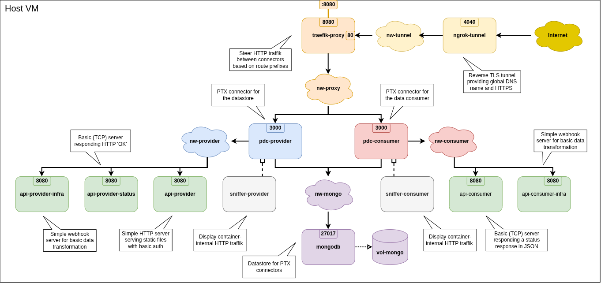
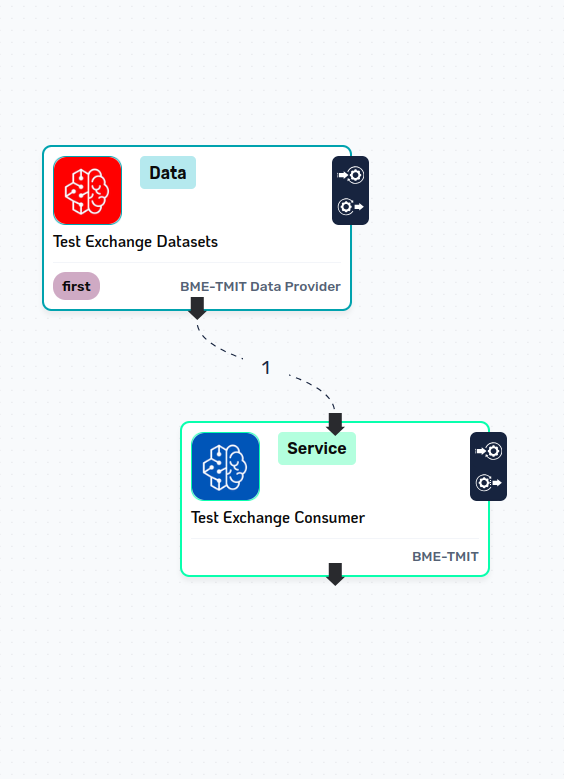
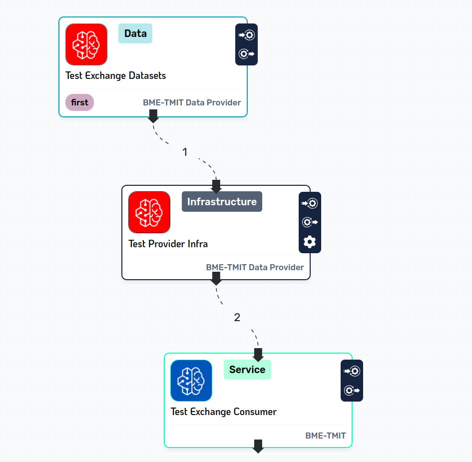
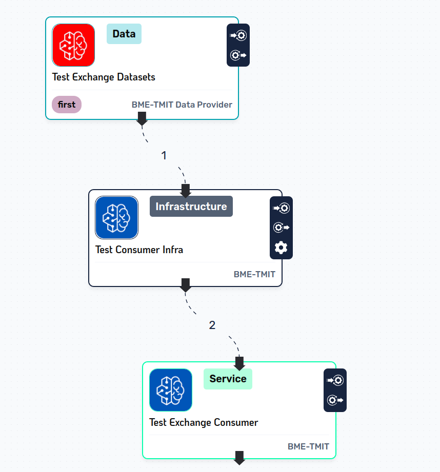
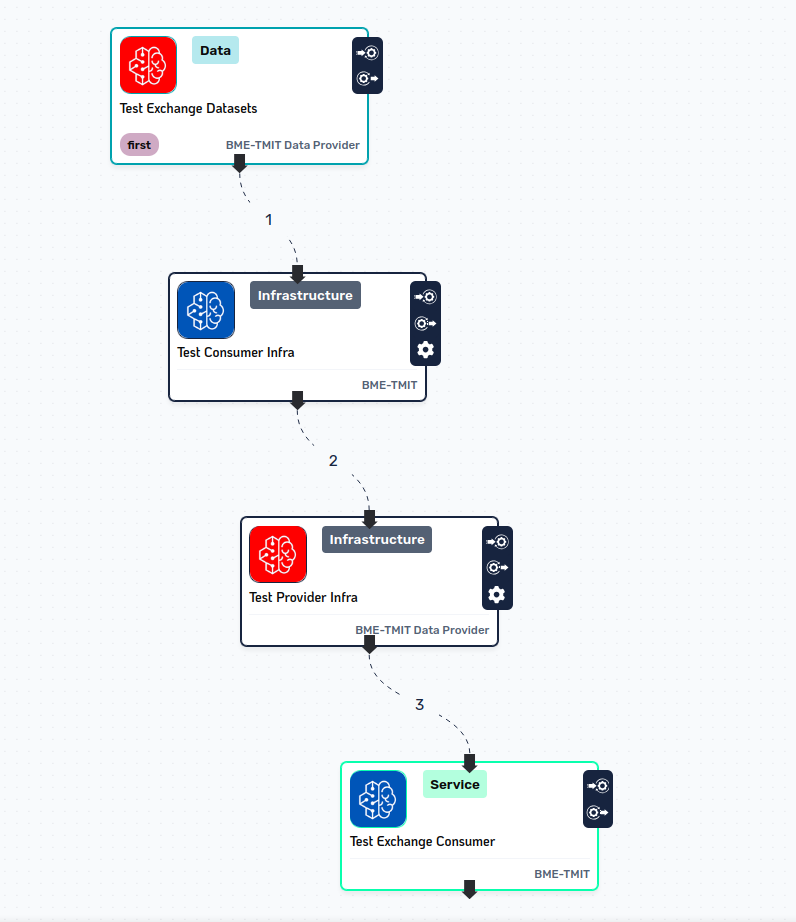
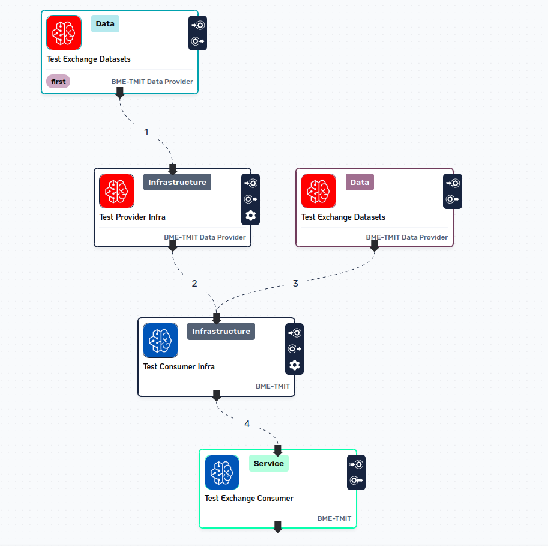

# Exchange Setup for Testing Data Exchanges via Vision's PTX Catalog

## Image Building

The [PTX dataspace connector](https://github.com/Prometheus-X-association/dataspace-connector) (PDC), HTTP packet sniffer, and webhook handler images must be
built beforehand as these are not available in remote repositories.

To build the required images, use the dedicated [Makefile](Makefile) target:

```bash
$ make build
```

## Infrastructure Setup

### Prerequisites

Data transfer in the PTX dataspace is orchestrated by VisionTrust's [catalog](https://visionstrust.com/), which requires
free registrations both for the data provider and the data consumer, separately.

Providing global access to the locally-managed PDC instances for the Vision catalog, a [ngrok](https://ngrok.com/)
reversed TLS proxy is configured, which also requires a free registration.

As a prerequisite, first copy the sample exchange config file ([creds/exchange.env.sample](creds/exchange.env.sample))
and provide the required parameters:

```bash
$ cp creds/exchange.env.sample creds/exchange.env 
```

Test exchange configuration can be given in the default `exchange.env` file (recommended)
or in a separate env file that is directly used by a `test_<...>.sh` script.

Mandatory variables, that need to be given for initiating the exchange setup:
- PDC **operation mode**: either `development` _(default)_ or `production`
>[!NOTE]
> Swagger API docs and verbose logging are only available in _development_ mode. 
- PDCs' **service** and **secret** keys for the provider and consumer, which can be found (currently)
  [here](https://visionstrust.com/dashboard/profile/settings?tab=api).
- ngrok's **authentication token** and a fix (dev) **domain name** that can be found (currently)
  [here](https://dashboard.ngrok.com/get-started/your-authtoken) and [here](https://dashboard.ngrok.com/domains).

Optional variables for prepared test cases:
- Signed **contract IDs**, which consolidates and designates the test data exchange and its participants.
- **Offer IDs** of the designated data provider, data consumer, and infrastructure nodes participating in the contracts.
- Exact **resource IDs** in the provider's data offer and the consumer's service offer participating in the test
  exchanges.
- **Service chain IDs** that encompass offers and describe moe complex data exchange structures.

Other setup configurations, such as exchange trigger keys or authentication secrets, can be also given here, which are
used by specific test cases or other test methods.
For further details, see [exchange.env.sample](creds/exchange.env.sample).

### Configuration

Dataspace components, i.e., PDC instances (provider and consumer), mongodb, and connected REST APIs, are configured
based on the PDC's [wiki](https://github.com/Prometheus-X-association/dataspace-connector/wiki) and fixed for this infrastructure setup.

Other infrastructure-related components, e.g., proxy, tunnel, etc., have a static configuration tailored to this setup
as well.

For the configuration details, check the infrastructure descriptor file [basic-infra.yaml](basic-infra.yaml),
specifically the inline config entries under the `configs:` key.

As an extension, packet sniffer containers can be directly attached to the PDCs' network stacks to collect and display
unencrypted HTTP traffic routed to API containers. To initiate these extra components along with the API containers,
use the dedicated setup configuration by executing `make setup-all` and check the containers' output using `make logs`.

### Infrastructure

To set up the exchange infrastructure, simply use the target:

```bash
$ make setup
```

To only initiate basic infrastructure components without provider/consumer/infra APIs,
use the dedicated target:

```bash
$ make setup-base
```

To initiate packet sniffers and examine PDC --> API invocations, use the following target:

```bash
$ make setup-all
```

To check component status, use the following target:

```bash
$ make status
```

To reattach and follow component logs, use the follwing target:
```bash
$ make attached
```

The container architecture, used networks, and communication patters are illustrated in the figure below.



The `traefik` (HTTP traffik steering) and `ngrok` (global HTTPS access) components also provides a web-based debug
interface for validating configuration and examining request-response pairs.

For security reasons, both interfaces are served via the traefik's dashboard port (**8080**) and can be accessed only
through a specific hostname bound to **localhost**.
However, the auxiliary port 8080 is not bound to any localhost IP, thus these interfaces can be accessed from
host machine in case the infrastructure is set up on a VM.
To access to ngrok's web interface on port **4040** directly, the relevant port expose settings should be uncommented
in the [base setup file](basic-infra.yaml#176).

The following URLs can be used for accessing the web interfaces:

- Reverse tunneling (`ngrok-tunnel`): http://ngrok.exchange.localhost:8080
- HTTP request routing (`traefik-proxy`): http://traefik.exchange.localhost:8080

According to the default [configuration](basic-infra.yaml), the following component URLs can be
also checked from outside the local setup by using the `ngrok` domain:

- Main datasource [PDC endpoint](basic-infra.yaml#364): **https://<NGROK_DOMAIN>/datasource/pdc**
- Main data consumer [PDC endpoint](basic-infra.yaml#371): **https://<NGROK_DOMAIN>/service/pdc**

PDC also provides a swagger based self-documenting web interface, but only in `development` mode.
See more in [configuration](#prerequisites).

- Datasource web interface: **https://<NGROK_DOMAIN>/datasource/pdc/docs/**
- Data consumer web interface: **https://<NGROK_DOMAIN>/service/pdc/docs/**

> [!IMPORTANT]
> Please mind the **trailing** `/` at the end of the PDC endpoints!

> [!NOTE] 
> Swagger API docs are only available in `development` mode ([PDC_ENV](creds/exchange.env.sample#4)). 

## Dataspace Settings

To create data/service offers and resources, as well as negotiating and signing a contract for the test exchange,
follow the related steps in 
 * VisionTrust's [Documentation](https://docs.visionstrust.com/application/onboarding.html) (in a more architectural level).
 * PDC's [GitHub wiki](https://github.com/Prometheus-X-association/dataspace-connector/wiki) (in a more technical level).

Dataspace-related configurations in the resource descriptions are the following:

### Data Resource Settings in the Datasource's Offer

Resource configuration defines the representation of the datasource's data-providing API.

1) **Static dataset - dp0 (CSV)**
   - Source Type: `REST`
   - URL: `http://api-provider:8080/dp0/data.csv`
   - Query Parameters: _(optional, for testing purposes)_
       - `test` _(defined as a constant value `true` in the exchange request)_
       - `param` _(takes the dynamic value of epoch time)_
   - Security: `API-key`
       - Credential identifier: `test-auth-basic` _(predefined in provider's PDC configuration)_
   - Select MIME type: `text/csv` _(Testing non-JSON data format)_
   - Input: `JSON` _(Back-propagated status info)_
   - Output: `CSV` _(Provider API returns a CSV file)_
   - "Is the data aimed to be an API payload ?" _(Consumer propagates back a status info)_
       - [x] Checked
       - Payload Representation: `REST`
       - URL: `http://api-provider-status:8080/consumption/result`
         _(Dedicated component for receiving the consumer's response)_

2) **Static dataset descriptor - dp0 (JSON)**
   - Source Type: `REST`
   - URL: `http://api-provider:8080/dp0.json`
   - Query Parameters: _(optional, for testing purposes)_
       - `test` _(defined as a constant value `true` in the exchange request)_
       - `param` _(takes the dynamic value of epoch time)_
   - Security: `None`
   - Select MIME type: `application/json` _(Testing JSON data format)_
   - Output: `JSON` _(Descriptor)_
   - "Is the data aimed to be an API payload ?"
       - [ ] Unchecked

### Service Resource Settings in the Consumer's Offer

Resource configuration defines the representation of the consumer's data-receiving API.

1) **Test Exchange Consumer (JSON)**
   - Source Type: `REST`
   - URL: `http://api-consumer:8080/api/exchange/json`
   - Query Parameters: _(optional, for testing purposes)_
       - `test` _(takes the query value from a global consumer param in the exchange request)_
       - `param` _(omitted, no value is defined in the exchange request)_
   - Security: `None` _(no authentication)_
   - Input: `CSV` _(Provider API sends a CSV file)_
   - Output: `JSON` _(Consumer API responds with a status info)_
   - "Is the resource an API?": _(Status info is propagated back to the provider)_
       - [ ] Unchecked

2) **Test Exchange Consumer (CSV)**
   - Source Type: `REST`
   - URL: `http://api-consumer:8080/api/exchange/csv`
   - Query Parameters: _(optional, for testing purposes)_
       - `test` _(takes the query value from a global consumer param in the exchange request)_
       - `param` _(omitted, no value is defined in the exchange request)_
   - Security: `None` _(no authentication)_
   - Input: `CSV` _(Provider API sends a CSV file)_
   - Output: `JSON` _(Consumer API responds with a status info)_
   - "Is the resource an API?": _(Status info is propagated back to the provider)_
       - [x] Unchecked

### Infrastructure Resource Settings

1) **Provider's Infrastructure Service** (configured for provider as an offer)
   - Category: `Trustworthy Data Sharing` _(Testing different categories)_
   - Input/Output: `JSON` _(Only supported format)_
   - URL: `http://api-provider-infra:8080/hooks/infra/async` _(Testing asynchronous chain resuming)_
   - Security: `None`
   - Query Parameters: _(optional, for testing purposes)_
       - `test` _(takes the query value from a global consumer param in the exchange request)_
   - Parameters Template:
     - `test`: Marking test mode (required, example value: `true`)
     - `node`: Infrastructure node owner (optional, example value: `infra-provider`)

2) **Consumers's Infrastructure Service** (configured for consumer as an offer)
   - Category: `Data Transformation` _(Testing different categories)_
   - Input/Output: `JSON` _(Only supported format)_
   - URL: `http://api-consumer-infra:8080/hooks/infra/sync` _(Testing service chain adapter)_
   - Security: `None`
   - Query Parameters: _(optional, for testing purposes)_
       - `test` _(takes the query value from a global consumer param in the exchange request)_
   - Parameters Template:
     - `test`: Marking test mode (required, example value: `true`)
     - `node`: Infrastructure node owner (optional, example value: `infra-provider`)

### Projects/Contracts

1) **Test Exchange** _(Testing in-project standard data exchange and API consumption)_
   - Orchestrator: Provider
   - Participant Offers:
     - Test Exchange Consumer (Data Consumer)
     - Test Exchange Dataset (Data Provider)

2) **Test Service Chain** _(Designated to define and test service chains)_
   - Orchestrator: Consumer
   - Participant Offers:
     - Test Exchange Consumer (Data Consumer)
     - Test Consumer Infra (Infrastructure service at Consumer side)
     - Test Exchange Dataset (Data Provider)
     - Test Provider Infra (Infrastructure service at Provider side)

### Service Chains

These chains are defined in the **Test Service Chain** project.

#### Chain Infra Basic

Designed for testing the minimal service chain with one data source and one consumer.


#### Chain Infra Provider

Designed for testing provider-side infrastructure service (provider and infra services share the same PDC).


Used parameters (Test Provider Infra):
```json
{
  "test": true,
  "node": "infra-provider"
}
```

#### Chain Infra Consumer

Designed for testing consumer-side infrastructure service (consumer and infra services share the same PDC).


Used parameters (Test Consumer Infra):
```json
{
  "test": true,
  "node": "infra-consumer"
}
```

#### Chain Infra Multi

Designed for testing a longer service chain with multiple connected infrastructure services.


Used parameters (Test Consumer and Provider Infra):
```json
{
  "test": true, 
  "node": "infra-multi-consumer"
}
```
```json
{
  "test": true,
  "node": "infra-multi-provider"
}
```

#### Chain Infra Complex

Designed for testing a complex data processing flow with multiple connected data sources. 


Used parameters (Test Consumer and Provider Infra):
```json
{
  "node": "infra-complex-provider",
  "test": true
}
```
```json
{
  "node": "infra-complex-consumer",
  "test": true
}
```

## Testing

To execute test, use dedicated targets starting with `test-` prefix (or directly with the helper scripts)
in [tests](tests) subdirectory.

Defined tests:

```bash
# Testing configuration setup and change
$ make test-config-api                  # Config change via private API
$ make test-config-file                 # Static config change and reload

# Testing credential creation
$ make test-credentials                 # creation via PDC API

# Testing standard data exchanges and API consumption
$ make test-exchange-consumer           # initiated at consumer
$ make test-exchange-provider           # initiated at provider
$ make test-exchange-api-consumption    # consumer response backpropagation

# Testing service chain definition and executions
$ make test-chain-basic-consumer        # initiated at consumer
$ make test-chain-basic-provider        # initiated at provider
$ make test-chain-infra-provider        # infra at provider
$ make test-chain-infra-consumer        # infra at consumer
$ make test-chain-infra-multi           # two infra services
$ make test-chain-infra-complex         # two datasource services
```

To see relevant logs, use the specific target:

```bash
$ make logs
```

## Tearing down

To tear down the infrastructure and delete intermediary files, use the following target:

```bash
$ make teardown
```

To redeploy the infrastructure, use the helper target (`teardown` + `setup`):

```bash
$ make restart
```

To stop the exchange setup containers and remove their images for cleanup, use the dedicated target: 
```bash
$ make purge
```
